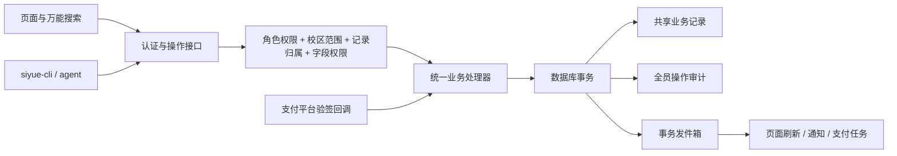

# 后端业务设计 v0.1

## 1. 结构

先采用单个服务、单个 PostgreSQL 数据库的模块化结构。各模块共享事务边界和稳定 ID，后续通过事务发件箱对接支付、消息与数据分析。浏览器页面、搜索、CLI 和 agent 共用操作服务，不能绕过权限直接改表。

| 模块 | 唯一事实来源 | 主要操作 |
| --- | --- | --- |
| 身份与权限 | 员工、账号、角色、功能授权、校区范围 | 账号启停、角色分配、档案授权 |
| CRM | 线索、来源登记人、当前负责人、归属历史、跟进记录 | 创建、保留、指派、转交、公海、回收 |
| 课程与教务 | 课程版本、讲次、班级、课次、老师、教室 | 课程发布、批量建班、排课、代课、教学记录 |
| 报名与学籍 | 报名权益、有效班级归属、课次名单 | 单个/批量报名、永久转班、临时转班、退课 |
| 商城与营销 | 商品版本、优惠版本、报价快照 | 从课程生成商品、优惠模板、发布收款版本 |
| 财务 | 订单、已核实收款、分摊、退款、不可覆盖的账务流水 | 欠费、收款二维码、收款核验、退款支付、对账 |
| 档案 | 同一学生/员工 ID 下的授权投影 | 学生、老师、职工档案与历史检索 |
| 审计与事件 | 操作请求、结果、字段变更、发件箱 | 全员分类检索、回溯、可靠通知 |

## 2. 权限

真实身份由服务器验证会话得到，禁止相信浏览器的“演示身份”、传入的员工 ID 或角色名。授权在搜索目录、详情读取、预览、执行四处独立校验。目录筛选不是执行许可。

权限由 `operation + campus scope + ownership + field access` 共同决定。销售通常查看本人线索；校长查看被授权校区；财务处理到账和退款；超级管理员可以授权档案查看。职工档案与老师档案分别授权，看到员工名不等于能看到合同、联系方式等敏感字段。被停用账号和角色立即失效；阻止删除或停用最后一个可用超级管理员。

数据库统一保存 `tenant_id`，复合外键防止跨机构引用。正式服务每笔事务设置可信机构上下文、对被授权校区取交集，再查记录；发布前还需实施并测试 RLS，应用角色不得绕过。**本目录尚未提供可运行的认证或 RLS 实现。**

## 3. 操作协议与一致性

1. 客户端从权限过滤后的目录获取操作和输入字段，页面打开一份办理表单。
2. `preview` 校验必要字段、金额、资格、冲突、章节一致性和数据版本，返回计算依据、影响范围与有时限的服务端预览凭据。
3. `execute` 必须携带 `Idempotency-Key`、预览凭据、对象的预期版本。服务端重新授权与校验，不信任客户端报价和统计值。
4. 在一个事务中按稳定顺序锁定受影响记录，核验版本；提交业务变更、操作结果、审计和发件箱。一项失败整笔回滚。
5. 返回请求 ID、新版本、结果 ID。其他页面从同一事实来源重新读取，事件只作为刷新提示。

幂等键按“机构、真实操作者、操作、键值”唯一；相同键及请求摘要返回原结果，相同键不同参数返回 409。请求摘要必须包含规范化操作输入与对象版本。服务端不能先写结果再异步写审计。审计或持久化失败时写入失败，禁止界面先显示成功。并发重复、网络超时重试、权限被撤销和预览过期都须单独测试。

失败业务事务先回滚，再在独立事务记录失败事件；不可把失败日志写进即将回滚的业务事务。未知身份的拒绝事件仅保留可确认的机构/请求上下文，不根据客户端自报身份伪造操作者。若审计服务不可用，停止需要审计的业务写入并告警。

批量操作先给出逐项预览与错误；v0.1 以整批原子提交为默认。大批量改为作业时，先记录整批请求、分组与逐项结果，每项独立幂等；只有明确选择的部分成功模式才可部分提交。没有实现时返回 501，不能悄悄降级。

## 4. 业务规则

### CRM 归属

登记人、来源渠道和当前负责人分开。销售本人录入可按规则保留；放弃保留时可指定转交；运营、地推、私域、活动来源默认进入公海，再由管理员分配。归属变更锁定线索版本，并追加归属事件；不覆盖原登记人。保留/回收策略先试运行，展示受影响线索，再发布不可变版本。定时回收与人工转交竞争时以版本冲突终止，避免错误回收。

### 课程、商城、优惠

课程使用草稿/已发布版本；每一讲有稳定讲次 ID、序号和授课内容。班级绑定具体课程版本，价格和资料有版本引用。商城商品草稿由课程带入标题、年龄、课纲、资料与价格；发布时保存快照。优惠模板（老带新、双人同行、续费等）校验适用对象、课程、时间、叠加和名额。已报名订单持有当时的报价/优惠快照，不能因之后修改模板而被追溯改价。新的优惠用于新报价或有审批记录的调价操作。

### 报名、转班、调课

同一学生不因再次报名而重复建档，关联通过 ID，姓名不作连接条件。订单未到账与报名权益未生效分开；按批准的赊欠规则可允许先进入名单，规则与额度必须留痕。批量报名逐个检查重复、年龄、容量、冲突、价格和优惠条件。

永久转班改变指定生效时间之后的班级归属，保留旧归属区间与历史课次。临时转班只改变指定课次的名单，默认匹配同一讲次；允许跨章节必须具有独立权限和原因。代课只改变指定课次授课老师。多个班级转校区与多名学生转班是不同操作；搬迁需同时校验教室、老师、学生时段及数据访问范围。

课表来源是课次、名单与老师分配，同一份数据投影为学生/老师时间色块或教室/校区表格。时间冲突按实际起止区间判断，不只比较相同开始时间。

### 退课与资金

退课资格与能否自动算退款分开：有可退报名关系的学生都可以申请。根据订单已确认实收、已确认课消、历史退款和合同规则计算；缺少讲次/收款资料时允许人工核定金额与依据，再由独立财务审核。缺少依据不能假定实收为零，也不能用前端按钮制造真实到账。

退课生效后撤销未来未完成的点名与补课预约，但保留历史教学、已确认课消、收款和退款记录，使用状态/冲正事件而非物理删除。退款支付和退课状态分开：`submitted → approved → processing → succeeded/failed`。同一订单可多次部分退款，但核验“已成功 + 处理中预占 + 本次”不超过可退实收；锁定订单及支付分摊，避免并发超退。

全部资金以整数分存储；接口限制在 JavaScript 安全整数范围，不传二进制浮点金额。折扣和分摊规定舍入方式：先按整数比例向下分配，剩余分按稳定顺序分配，分摊和必须等于总额。资金流水追加不可覆盖，错误通过引用原流水的冲正处理。

欠费行的“已付费”将进入收款核验页面，只有具有财务权限的人员能录入有凭据的线下收款；线上支付以验签后的渠道回调和主动查询对账为准。二维码仅由服务器向支付渠道申请，返回短时支付链接/二维码，不嵌入学生私人资料。不在仓库保存渠道密钥。

## 5. 审计与可靠事件

正式审计覆盖所有真实账号的查看敏感档案、搜索、创建、修改、授权、收退款、导出、失败及拒绝行为，记录请求 ID、操作者、所属校区、入口（页面/搜索/CLI/agent/回调/任务）、分类、对象 ID、结果、理由及脱敏字段差异。超级管理员按人、日期、分类、对象和结果检索；普通用户不获得全员日志权限。查询或导出日志本身也追加审计。

数据库审计表禁止普通应用角色 UPDATE/DELETE，表内触发器提供额外保护；数据库管理员仍可绕过，不能将其称为不可篡改存证。正式环境需外部只追加备份、保留周期、访问记录和恢复演练。敏感字段加密保存，审计只保留必要脱敏差异；密码、令牌、支付签名、完整证件绝不进入日志。

业务事务把事件写到 `outbox_events`。后台任务锁定待投递项、重试与告警；消费者按事件 ID 去重。投递可能重复，不能假定只投递一次。支付回调先验签、防重放、核对商户与金额，再以渠道交易/事件 ID 唯一去重。回调失败不返回虚假成功。

## 6. 落地顺序与验收

1. 在空测试库执行迁移，验证跨机构外键、唯一键、资金边界、追加日志限制和迁移回滚/恢复方案；目前未执行数据库迁移。
2. 实现认证、权限、目录过滤、只读查询和审计入口；验证跨校区与字段授权。
3. 逐项实现 CRM、课程与报名处理器；把原型状态迁移为服务端 ID 和版本，不从姓名推测关联。
4. 实现教务变更与退课；测试并发名额、章节匹配、未来名单撤销、历史保留及部分退款。
5. 接入支付沙箱与财务对账，验证签名失败、重复回调、金额不符、超时、退款失败和重试。
6. 将页面、搜索与 CLI 逐项连到同一接口；清楚区分已接入与仍为原型的操作。开放部署前完成权限测试、数据导入演练与恢复演练。
