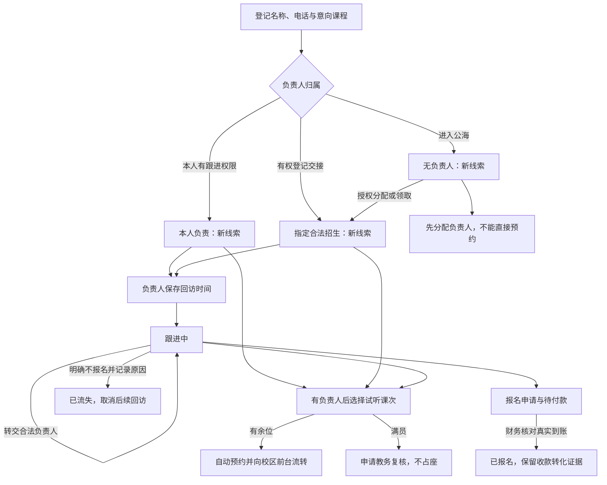

# 线索阶段、归属与前台预约

线索阶段与负责人分配状态独立。登记、本人保留、分配、领取或转交只改变归属，不因有负责人就把新线索变成跟进中。授权负责人保存有效回访时间（跟进表单或资料内的回访编辑）后，首次进入跟进中。只记沟通或系统自动记录试听，不替代这个触发条件。

取消回访不会把已经开始跟进的线索自动退回新线索。服务器保存首次回访启动标记；旧记录结合现有回访或历史中的真实回访证据读取，避免用旧的负责人投影反复覆盖阶段。显式释放公海、策略回收、归档恢复仍保留原有流程重置和审计，不与取消回访混用。已报名、已流失、已归档等状态不会被分配或自动试听记录覆盖；流失线索须走授权恢复流程。

运营保留登记和读取权，可在新建时按授权校区交接给具有跟进权限的招生人员，也可以进入公海；这不等于拥有既有线索分配权限。运营不能自领跟进、保存跟进、改派既有线索、报名或确认收款。前台登记与普通登记采用相同的本人、指定、公海归属语义；公海不能直接进入预约。前台预约仍校验负责人、校区、真实课次、余位、冲突、版本、幂等与审计。

名称允许姓名、昵称或微信名，线索详情不再重复展示家长姓名。新建的默认获客线索模板使用单一名称，不要求学生与家长双姓名；既有自定义模板、历史家长字段及提交答案继续保留。资料编辑保留既有授权，不因字段统一放宽运营权限。

同一身份、同一档案、同一状态从线索登记及我的线索进入同一详情/跟进工作页。本人负责人具备跟进和试听操作；未分配、归档或没有跟进授权的档案按同一规则只读。流程变更须同时验证登记响应、刷新后的详情与查询结果，不能仅凭界面标签验收。
