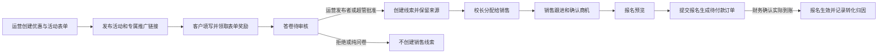

# 运营获客到销售报名

运营创建并发布促销活动、获客表单及推广链接，收集和读取线索。运营不跟进线索、不分配销售、不办理报名、不确认到账。校长在授权校区内分配；销售跟进本人线索、确认购买需求并办理报名；财务核对实际凭据后确认到账。

公开提交、答卷审核、报名及确认到账均保留服务端授权、版本、幂等和审计。表单提交及报名预览不等同于成单；实收由财务确认，不由运营或销售自行操作。

同一提交重复审核不重复生成获客触点；新生同时关联原线索和商机时，可以复用本次事务新建的同一学籍，但仍拒绝与客户已有其他学籍冲突。姓名和电话不一致、跨校区或越权请求保持拒绝。

员工正式密码至少10位，可使用纯字母；不能包含账号或控制字符。密码修改继续验证当前密码，并撤销旧会话；账号、角色和业务授权规则不因密码格式调整而变化。

验收用例 `backend/test/operations-acquisition-journey.test.cjs` 通过真实HTTP接口使用隔离的运营、校长、销售、其他销售和财务身份，覆盖活动、优惠、推广来源、匿名答卷、重复提交、审核、线索分配和跟进、商机、优惠抵扣、报名预览/执行、模拟到账、成单归因和审计。生产界面只读核对与隔离库写入测试分别报告。
