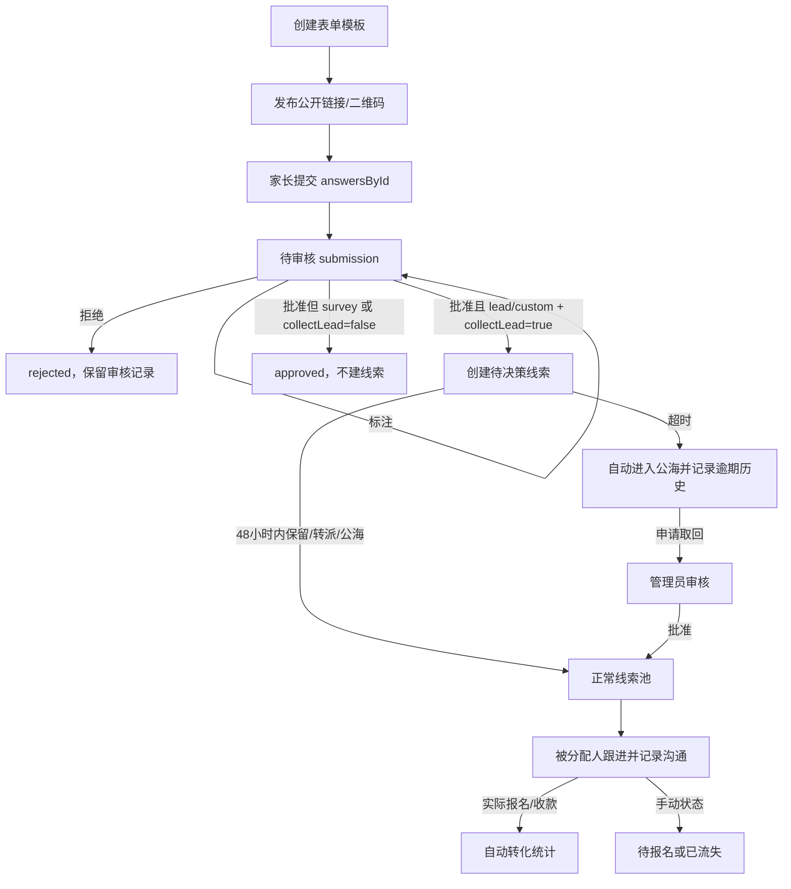
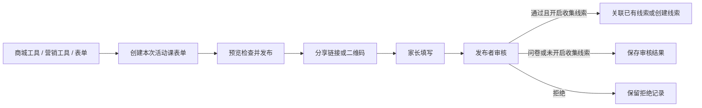

# 思跃表单与线索工作流

## 流程



## 表单入口与活动课使用

统一从「商城工具 → 营销工具 → 表单」进入，和拼团、联报、优惠券并列；「获客管理」不再重复放置表单管理入口。搜索「表单」「营销表单」「活动课报名」也可打开同一表单管理页。

每次活动课可新建独立表单，填写活动名称、收集字段、校区、来源渠道、收集份数和每人填写上限，发布后分享公开链接或二维码。需要销售跟进时选择线索登记模板；仅做问卷统计时选择家长问卷；其他场景使用自定义表单并明确是否收集线索。预约课次、资料领取与优惠券设置沿用现有表单配置。

表单页中的「提交审核」与「获客管理 → 提交审核」使用同一审核列表，不复制提交记录。新提交先进入待审核；是否进入线索池仍由表单用途和审核决定，保持原有发布者、校区范围及审计规则。



## 表单和审核

表单由服务端 `form.*` 操作管理，公开填写走公开表单 API。内置线索登记模板使用 `kind: "lead"`、`collectLead: true`；家长问卷使用 `kind: "survey"`、`collectLead: false`。自建模板使用 `kind: "custom"`，是否进入线索池由 `collectLead` 明确控制。模板字段保存在服务端，公开提交将答案按字段稳定 ID 写入 `answersById`，并保存 `fieldSnapshot`。

`form.submit` 仅创建 `pending` 提交，不会直接创建平台线索。审核人员可以先用 `form.submission.annotate` 添加备注和标签，再用 `form.submission.review` 的 `approve` 或 `reject` 决策。只有 `lead` 或 `custom` 且 `collectLead` 为真时，批准才会创建线索。问卷批准只完成问卷审核。

待审和拒绝的提交内容仅表单发布者与超级管理员可见。审核操作还要求当前账号拥有 `lead.create`；服务端再核对发布者本人或超级管理员身份，没有独立的 `form.review` 权限。已批准提交按表单和服务端投影范围可见；线索明细仍按线索权限裁切。普通员工可以登记和收集线索，但没有销售权限时只能查看自己收集的状态，不能办理销售流程。

## 线索决策和跟进

新创建或审核入库的线索进入待销售决策状态，`decisionDeadline` 默认是入库时间后 48 小时，可由管理人员通过线索策略调整。被分配销售可在期限内选择保留、转给其他销售或放入公海。未获 `lead.follow` 权限的发布人创建的线索进入公海，同时保留发布人与来源信息。后台到期处理自动释放超时线索，并写入决策历史；历史超时记录不会因后续重新分配而删除。

决策状态包括 `pending`、`retained`、`transferred`、`public`、`timed_out` 和审批取回后的 `reclaimed`。超时线索申请取回使用 `lead.reclaim.request`，必须说明理由；管理人员使用 `lead.reclaim.review` 批准或拒绝。批准的取回仅分配给申请人。跟进记录使用 `lead.followup`，沟通方式限定为电话、线上会议或现场沟通，跟进内容必填，预约时间可选。实际报名状态由报名记录同步，不允许手工把线索标成“已报名”；手动可设阶段为“跟进中”“待报名”或“已流失”，其中终态只有“待报名”和“已流失”。

## 权限

| 能力 | 主要权限 | 可见范围 |
| --- | --- | --- |
| 创建/编辑/发布本人表单、收集线索 | `lead.create` | 本人表单与登记人可见状态 |
| 查看提交/审核本人发布的提交 | `lead.create` 且为该表单发布者 | 待审和拒绝的内容仅发布者本人或超级管理员；已批准按表单与投影范围 |
| 超级管理员应急审核提交 | `lead.create` 且超级管理员角色 | 可查看和审核各发布者提交；不会替发布者执行销售决策 |
| 线索销售决策、转派、公海和跟进 | `lead.follow`、`lead.assign`、`lead.transfer`、`lead.release` | 服务端当前员工/校区/管理范围 |
| 超时取回申请 | `lead.follow` | 本人可申请且只可请求分配给本人 |
| 审核取回申请、修改决策策略 | 管理端对应线索授权 | 授权范围 |
| 销售汇总 | `lead.conversion.read`；管理端可用 `report.read` | 服务端按员工/校区范围聚合 |
| 销售操作事件 | `audit.read`（管理侧）或 `sales.activity.read`（销售本人） | 管理授权范围或本人事件 |

最终权限以当前服务器 `catalog` 和端点授权为准；客户端页面隐藏不替代服务端检查。

## 统计口径

- `from` / `to` 按线索分配时间筛选归属批次（含边界）；仅日期时按北京时间整日计算，显式带时区的时间按其瞬时值筛选。响应的 `cohort` 为 `assignment`；分配数是批次内有销售归属快照的唯一线索数，重复记录不重复计数。
- 转化按该线索产生的实际报名及订单收款记录计算，并以首次实收时冻结的归属快照记给当时销售。转派不把已发生的转化挪给新销售。
- 转化率为转化唯一线索数除以分配唯一线索数。样本少于 10 时 `conversionRate` 和 `overdueRate` 都返回 `null`；界面可显示计数和“样本不足”，不提供原始率。
- 转化金额为归属销售的实收金额减已确认退款金额，单位为分；未收款、已取消订单不算转化金额。
- 平均转化时长从归因销售在转化前最近一次获得该线索的时间算起，仅纳入已转化线索；重复分配时不使用更早的首次分配时间。
- 平均转化时长只纳入能找到转化前有效分配记录的转化；`conversionDurationCoverage` 返回纳入计算的数量，历史缺失时该线索不计入平均值，也不猜测分配时间。
- 超时数和超时率按存在超时决策事件的唯一线索统计，保留历史记录；一次线索仅计一次超时。转化率和超时率分母均为分配线索数，样本少于 10 时两项率都返回 `null`。
- 操作日志来自服务端事件，按时间、员工、线索或操作过滤，不根据当前线索字段推断历史。日志只提供操作、时间、结果和必要的记录摘要，不返回跟进正文、表单答案等敏感内容。

## API 与 CLI

浏览器操作通过业务目录的 `preview → execute` 流程提交，避免绕过服务器授权、校验和审计。公开表单提交只使用服务端发放的 submission key 和幂等键，不需要员工登录，也不会向家长暴露其他答卷。

| 用途 | 路径/操作 |
| --- | --- |
| 创建/更新/发布表单 | `form.create` / `form.update` / `form.publish` / `form.unpublish` |
| 公开表单提交 | `form.submit`（返回 `status: "pending"`） |
| 标注/审核提交 | `form.submission.annotate` / `form.submission.review` |
| 线索决策与回收 | `lead.retain` / `lead.transfer` / `lead.release` / `lead.reclaim.request` / `lead.reclaim.review` |
| 记录跟进/状态 | `lead.followup` / `lead.status.update` |
| 销售统计 | `GET /v1/reports/sales?employeeId=…&from=YYYY-MM-DD&to=YYYY-MM-DD` |
| 销售操作日志 | `GET /v1/sales/activity?employeeId=…&leadId=…&from=…&to=…&action=…&limit=…&cursor=…` |

CLI 示例（所有查询由当前登录身份授权，筛选不会扩大权限）：

```sh
node cli/siyue-cli.cjs get sales-report --employee <员工ID> --from 2026-10-01 --to 2026-10-31
node cli/siyue-cli.cjs get activity --employee <员工ID> --from 2026-10-01 --to 2026-10-31 --action lead.followup --limit 50
node cli/siyue-cli.cjs get teacher-report --employee <教师员工ID>
node cli/siyue-cli.cjs get teacher-report --employee <教师员工ID> --days 60
```

教师统计使用 `GET /v1/reports/teachers?employeeId=...`。教师本人通过 `teacher.metrics.read` 查看自己的全周期数据；查看其他教师需要 `report.read`，并受全校或校区范围约束。统计分为已归因课消记录、授课节数、学生课消人次和实收课消金额。历史教师快照未知的记录单独列出，不推算给当前班主任。

续费率使用指定观察窗，默认 30 天，可在 CLI 用 `--days 1..365` 调整。分母为已进入观察窗的结课学生，观察期内的结课学生另列为待观察；历史归因不全时显示未知数量和原因。转介绍率只在教师归因和推荐订单证据完整时展示；数据不完整时显示计数、未知订单数和原因，不补造比例。教师可在“我的课程”查看本人实际授课课次；异常考勤仅可登记北京时间当天的请假或旷课，未列异常者由服务端按提交时的实际名单记录正常到课。调课申请保留原课次讲时，审批人只能在获授权校区内处理且不能批准自己的申请。

CLI 输出为服务端汇总或审计事件响应。不要将包含业务记录的结果写入公开仓库；CLI 不支持直接改写这些统计或审核状态。
